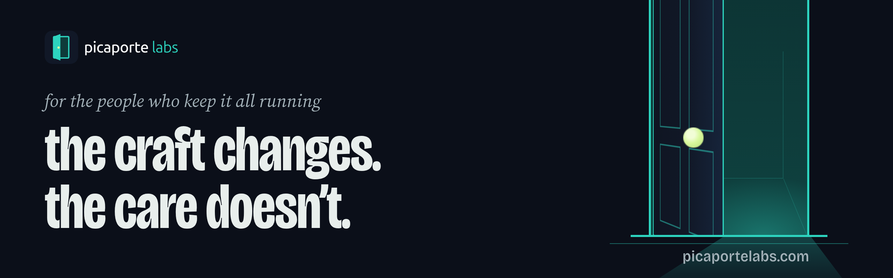
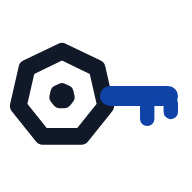

  <a href="https://picaportelabs.com/">picaportelabs.com</a> ·
  <a href="https://picaportelabs.com/blog/">Blog</a> ·
  <a href="https://www.linkedin.com/company/picaporte-labs/">LinkedIn</a> ·
  <a href="mailto:hola@picaportelabs.com">hola@picaportelabs.com</a>

AI is changing how software is written, shipped and run: agents already open pull requests and change cloud infrastructure alongside people. Picaporte Labs is a small software studio in Spain making tools for that shift: few, sharp, and honest about what they don't do.

## What we make

<table>
  <tr>
    <td width="96" align="center" valign="top"></td>
    <td valign="top">
      <strong><a href="https://kubelatch.com/">kubelatch</a></strong>, stop messing with Kubernetes credentials. 
      A credential broker for Kubernetes: every person, every CI pipeline and every AI agent gets a credential of their own for your clusters. Each one has an owner, an expiry and a record of every request, and can be revoked instantly. Free for up to 2 clusters and 5 people, with no time limit. 
      <a href="https://kubelatch.com/">kubelatch.com</a> · <a href="https://docs.kubelatch.com/">Docs</a> · <a href="https://github.com/picaportelabs/kubelatch/releases">Releases</a>
    </td>
  </tr>
</table>

## Four things we hold to

1. **Honest about boundaries.** A tool should say what it does not do, on the page where you decide whether to use it.
2. **Private by default.** No telemetry and no cookies. Our sites count visits with Umami on our own server, without keeping your IP address. License keys are verified offline; the only call kubelatch makes to us is a daily version check that carries no identifier, and one setting turns it off.
3. **For people and agents.** Each one, person or agent, gets its own identity and its own limits; an agent's writes can wait for a person's approval, and everything is on record.
4. **Your infrastructure, your data.** Our tools run where you run them: kubelatch installs in your own Kubernetes with a Helm chart, and works air-gapped too.

## From the blog

- [An AI agent on your cluster, without your kubeconfig](https://picaportelabs.com/blog/ai-agent-without-your-kubeconfig/)
- [GitHub Actions to Kubernetes without a secret](https://picaportelabs.com/blog/github-actions-without-a-secret/)
- [What Free keeps, forever](https://picaportelabs.com/blog/what-free-keeps/)
- [Why kubelatch exists](https://picaportelabs.com/blog/why-kubelatch-exists/)

All posts at [picaportelabs.com/blog](https://picaportelabs.com/blog/), with an [Atom feed](https://picaportelabs.com/blog/feed.xml).

## Write to us

Anything about Picaporte Labs goes to [hola@picaportelabs.com](mailto:hola@picaportelabs.com), and anything about kubelatch to [hello@kubelatch.com](mailto:hello@kubelatch.com), in English or Spanish. A vulnerability goes to [security@kubelatch.com](mailto:security@kubelatch.com), as the [security policy](https://kubelatch.com/security/) describes.

<strong>En español</strong>

 

*Para quien mantiene todo en pie.* **Cambia el oficio. No cambia el cuidado.**

La IA está cambiando cómo se escribe, se despliega y se opera el software: los agentes ya abren pull requests y cambian infraestructura en la nube junto a las personas. Picaporte Labs es un pequeño estudio de software en España que hace herramientas para ese cambio: pocas, precisas y honestas con lo que no hacen.

**Lo que hacemos.** [kubelatch](https://kubelatch.com/es/) es un intermediario de credenciales para Kubernetes: cada persona, cada pipeline de CI y cada agente de IA tiene su propia credencial para tus clusters, con dueño, caducidad y registro de cada petición, y se puede revocar al instante. Gratis hasta 2 clusters y 5 personas, sin límite de tiempo. [Documentación](https://docs.kubelatch.com/es/) · [Releases](https://github.com/picaportelabs/kubelatch/releases)

**Cuatro cosas que sostenemos.** Honestos con los límites: una herramienta dice lo que no hace. Privado por defecto: sin telemetría y sin cookies. Para personas y agentes: cada uno con su identidad y sus límites, y todo queda registrado. Tu infraestructura, tus datos: nuestras herramientas se instalan donde tú las ejecutas.

**El blog** está en [picaportelabs.com/es/blog](https://picaportelabs.com/es/blog/).

**Escríbenos.** Cualquier cosa sobre Picaporte Labs, a [hola@picaportelabs.com](mailto:hola@picaportelabs.com), y sobre kubelatch, a [hello@kubelatch.com](mailto:hello@kubelatch.com), en español o en inglés. Una vulnerabilidad, a [security@kubelatch.com](mailto:security@kubelatch.com).

Made in Spain, in English and Spanish.
